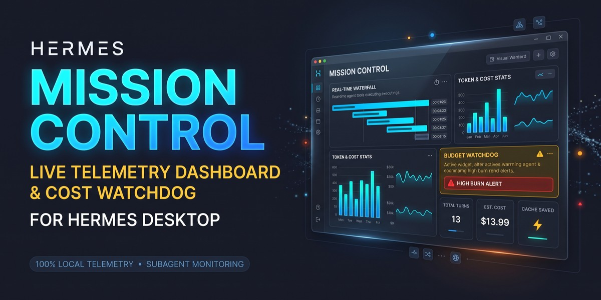
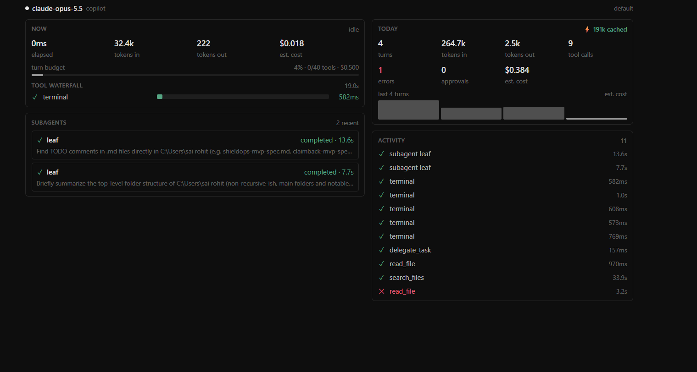

# Mission Control

**A live mission-control dashboard inside Hermes Desktop.** Every tool call, model call, subagent and approval streams into one pane while your agent works — with token and estimated-cost meters, a ⚡ prompt-cache badge, and a budget watchdog that flags a runaway turn before it burns money.

Read-only. Everything stays on your machine.



## Quick start

```bash
hermes plugins install rohitkumardanda/hermes-mission-control --enable
```

1. Restart the gateway: **⌘K → Restart gateway** (the hooks load at gateway start).
2. In Hermes Desktop open **Capabilities → Plugins**, click **Rescan**, and switch **Mission Control** on (Desktop halves ship off by default).
3. Run any task. Watch the **Mission Control** pane on the right, the **◎ chip** in the status bar, or open the full page from the sidebar / **⌘K → Mission Control: Open dashboard**.

Requires Hermes **0.21.6** or newer.

## What you see

| Card | What it shows |
|---|---|
| **Now** | Turn state (thinking / running N tools / N subagents working / idle), elapsed time, tokens in and out, estimated cost, and the turn **budget bar** — amber past 80 %, red past 100 % with a pulsing **⚠ High token burn** banner. |
| **Tool waterfall** | Every tool call as a bar on one timeline. Running calls pulse and grow with a live stopwatch; finished calls snap to green ✓, red ✕ (hover for the error type) or grey ⊘ (cancelled/blocked). The last run stays on screen until the next one. |
| **Subagents** | One card per delegated subagent, ticking while it runs — parallel subagents tick side by side. Click a finished card for its summary. |
| **Today** | Turns, tokens, tool calls, errors (with retried model calls on hover), approvals and denials, estimated cost, the **⚡ cached** badge with cache hit rate, and a sparkline of the last 12 turns. |
| **Activity** | A feed of tool calls, failed or retried model calls, subagents and approval decisions. |
| **Status-bar chip** | Spinner while the agent works, plus today's tokens and cost; turns amber or red when the current turn is over budget. Click it to open the full page. |

When a turn crosses a budget you get **one** in-app toast for that turn (plus an OS notification if Hermes is in the background). The watchdog only alerts — it never stops or changes the agent.

## How it works

```
agent turn (gateway process)                      Hermes Desktop
┌─────────────────────────────────────┐          ┌──────────────────────────────┐
│ 8 observer hooks  ──►  in-memory     │  push    │ desktop/plugin.js            │
│ (tools, model calls,   store (bounded│ ───────► │  pane · chip · page ·        │
│  subagents, approvals) deques, lock) │  + poll  │  ⌘K commands · settings      │
│ dashboard/plugin_api.py              │ ◄─────── │                              │
│  GET  /api/plugins/mission-control/  │          │                              │
│       snapshot · events?since=N      │          │                              │
│  POST /api/plugins/mission-control/  │          │                              │
│       reset                          │          │                              │
└─────────────────────────────────────┘          └──────────────────────────────┘
```

- **Collect.** Eight read-only observer hooks (`pre_tool_call`, `post_tool_call`, `post_api_request`, `api_request_error`, `subagent_start`, `subagent_stop`, `pre_approval_request`, `post_approval_response`) write into a small in-memory store. Every hook is fail-open: it can never raise into the agent loop.
- **Deliver.** Each event is pushed to the Desktop the instant it happens through Hermes's public plugin event bridge (`hermes_cli.plugin_events`). The pane also polls `/events?since=N` (every second while work is running) so nothing is missed, and refreshes `/snapshot` for the aggregates. Events carry a sequence number, so overlapping feeds never double-count.
- **Roll up.** A subagent's model and tool calls count toward the turn that delegated it, so a turn's cost and budget include its subagents.
- **Forget.** The store is bounded (500 events, 100 turns, 50 subagents) and lives in memory only. Daily counters roll over at local midnight; everything clears on gateway restart or from **⌘K → Mission Control: Reset today's stats**.

## Cost estimates

Costs are labelled **est.** on purpose. They come from a bundled per-1M-token price table (input, output, cache read, cache write) whose rows mirror the official-docs pricing snapshot that ships with Hermes 0.22.5 (Anthropic, OpenAI, Google, DeepSeek, Amazon, Fireworks), plus a few community rows. As of **2026-11-10**.

- Model names are normalised before lookup, so `anthropic/claude-sonnet-4.6`, `claude-sonnet-4-6-20250414` and Bedrock ids all match.
- A model that isn't in the table shows **—**, never a misleading $0.
- Subscription providers (GitHub Copilot, Codex) show a **list-price equivalent**; the tooltip says so. Your plan isn't billed per token.
- Context-tier surcharges (for example >200k-token Gemini prompts) are not modelled.

## Settings

**Settings → Plugins → Mission Control**

| Setting | Default | |
|---|---|---|
| Show estimated cost | on | Hide every cost figure. |
| Alert on high token burn | on | The once-per-turn toast / OS notification. |
| Turn cost budget | $0.50 | Per-turn estimated cost that turns the bar red. `0` = off. |
| Turn tool-call budget | 40 | Tool calls in one turn before the bar turns red. `0` = off. |
| Activity feed size | 30 | 15, 30 or 60 events. |
| Reset today's stats | | Clears counters, turns and the feed. |

## Troubleshooting

| You see | Do this |
|---|---|
| **Connect a gateway to stream telemetry** | Hermes Desktop isn't connected to a gateway. Start or reconnect it. |
| **Backend not loaded** | The Python half isn't enabled: `hermes plugins enable mission-control`, then **⌘K → Restart gateway**. On a very old Hermes, update. |
| **Hooks are not reporting to this gateway** | Restart the gateway after enabling. If `dashboard.turn_isolation` is on, turns run in a separate child process the dashboard can't read; turn it off to use Mission Control. |
| Nothing appears in Plugins | **Capabilities → Plugins → Rescan**, then switch it on. |
| Edits to `desktop/plugin.js` don't show | Desktop runs a copy; **Rescan** refreshes it (a linked checkout refreshes automatically). `hermes plugins doctor mission-control` reports a stale copy. |

With `plugins.isolation: host`, hooks and routes both run in the plugin host and the dashboard works through polling (about a second behind instead of instant).

## Disclosure

In-process only: reads observer-hook telemetry and serves it over Hermes's own plugin API to the connected Desktop. No third-party network calls, no shell commands, no background processes, no stored credentials, no telemetry of its own.

In detail:

- **Reads:** only the hook payloads Hermes passes to it. It does not record tool arguments, tool results, prompts or replies — only tool names, statuses, durations, error types, token counts, model and provider names, subagent goals and summaries (truncated), and approval decisions.
- **Writes:** nothing to disk. Telemetry lives in process memory; your settings live in the Desktop's own plugin storage.
- **Network:** none of its own. Events reach the Desktop through Hermes's local plugin API and event bridge.
- **Agent:** never written to. No tools, no middleware, no approval answers.

## Development

```bash
python tests/test_store.py        # store, rollup, pricing, routes, hook parity (stdlib only)
python tests/test_push.py         # the Desktop push bridge
python tests/e2e_http.py          # mounts the routes on Hermes's real web server (Hermes venv)
python tests/desktop_state.py state.json
node tests/desktop_smoke.mjs state.json <dir with react, react-dom, nanostores>
hermes plugins validate .
```

`desktop_smoke.mjs` loads the real `desktop/plugin.js` with React 19 and a stub SDK, renders every surface, and fails on any React warning. A Hermes checkout's `apps/desktop` folder works as the module directory.

To develop against a live Desktop, link the checkout into your plugins folder — Desktop then hot-reloads every save of `desktop/plugin.js`:

```bash
ln -s ~/src/hermes-mission-control ~/.hermes/plugins/mission-control          # macOS / Linux
New-Item -ItemType Junction -Path "$env:LOCALAPPDATA\hermes\plugins\mission-control" -Target .   # Windows
```

## License

MIT — see [LICENSE](LICENSE).
